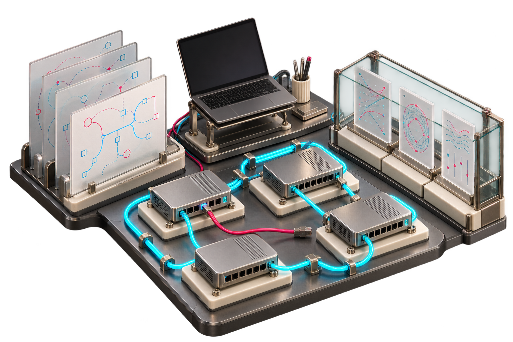

# Network Lab Factory

[](https://github.com/carlosalpo/network-lab-factory/actions/workflows/ci.yml)

**Turn a network exercise into a prepared, repeatable lab.**

Network Lab Factory is a guided terminal assistant for EVE-NG and a documented GNS3 3.0.6 profile. Choose a scenario, select compatible installed images, adjust address pools, inspect the topology, and confirm creation. The assistant creates and connects devices, applies the base configuration, and checks the result.


*Actual Textual interface rendered with fixture inventory. The interface is in Spanish. Live network observations are recorded separately below.*

## What you can build

The [catalog](docs/catalog/README.md) contains **24 implemented variants**:

| Level | Scenarios |
|---|---|
| Basic | OSPF point-to-point, static routing, VLAN/trunk, LACP, Spanning Tree, three- and four-switch rings, inter-VLAN routing |
| Intermediate | Three-tier campus, multi-area OSPF, dual-WAN branch, redundant gateway, BGP, VRF, ACL/NAT, IPv6/dual stack |
| Advanced | Nexus vPC, VXLAN EVPN, MPLS L3VPN, redistribution, BGP multihoming, ASA segmentation, troubleshooting, NX-OS version comparison |

Every scenario documents its topology, prerequisites, device/image profiles, resources, pools, prepared configuration, learner exercise and acceptance checks. The catalog currently offers fixed variants, not arbitrary topology generation or universal support for vendor images.

## Practice or reference

- **Practice:** prepares and checks the prerequisites; leaves the exercise for you.
- **Reference:** also applies the exercise solution and requires its checks to pass.

A single recipe drives the configuration, ASCII preview and native lab labels. The terminal supports dark, light and monochrome themes, keyboard navigation, compact layouts, device consoles, and recorded checks. Available fault/restore actions are explicit and invalidate prior observations until rechecked.

## Recorded validation

**24/24 reference scenarios passed on EVE-NG and 24/24 on GNS3.** The [validation matrix](docs/catalog-validation.md) links all 48 observations. Additional evidence covers five GNS3 practice samples, selected fault/recovery cases and Nexus automatic boot after power-off. **217 local tests passed** during the campaign; CI also runs the local suite across its configured Python versions.

These are dated results from documented images and installations, not performance, convergence, production-readiness or universal-compatibility claims. Some attempts failed and were repeated after corrections; the report explains those corrections. The [public evidence](docs/evidence/catalog/README.md) retains device observations and excludes private transport and administration records.

[QA cleanup](docs/cleanup-validation.md) removed all 41 EVE-NG labs and 49 GNS3 projects created for the campaign. Existing projects and base images were preserved.

## Quick start

Python 3.11+:

```sh
git clone https://github.com/carlosalpo/network-lab-factory.git
cd network-lab-factory
python3 -m venv .venv
source .venv/bin/activate
python -m pip install -e '.[dev]'
nlf wizard
```

```sh
nlf wizard --theme light
nlf wizard --theme mono
nlf wizard --plain
nlf catalog
nlf plan B03 --name vlan-trunk --mode reference --output build/vlan-trunk
nlf plan A02 --backend gns3 --name evpn-practice --output build/evpn-practice
```

Planning and local tests need no server. Deployment needs an authorized lab server, the documented runtime and compatible OS images already installed. Proprietary images are not included or downloaded. The [guide](docs/workshop-wizard.md) explains SSH authentication, the optional GNS3 guest-agent transport, image profiles and limitations.

Deployment creates a new lab and refuses an existing destination. Interrupted deployments retain partial records and may retain running nodes; inspect their state before recovery. The interactive product does not silently retry, overwrite or delete existing labs. QA cleanup is a separate, explicit operation.

## Explore

- [24 illustrated scenario guides](docs/catalog/README.md)
- [Wizard setup, navigation and troubleshooting](docs/workshop-wizard.md)
- [Recorded validation and limitations](docs/catalog-validation.md)
- [Actual terminal interface captures](docs/screenshots/workshop/README.md)

## Earlier dual-WAN compiler workflow

The original YAML/Ansible workflow remains available alongside the catalog assistant. Its historical v0.1.1 evidence and manual bootstrap scope are described below; those instructions do not describe the newer wizard's automated preparation.


## What is included



*Conceptual illustrations of the lab and engineering workflow. See the [dual-WAN scenario](examples/dual-wan.yml) for the exact topology and [live validation](docs/live-validation.md) for measured results.*

| Stage | Deliverable |
|---|---|
| Validate | Reject duplicate IPs, subnet overlaps, reused ports, disconnected nodes and unknown fields |
| Build | EVE-NG `.unl`, Ansible inventory, IOS routing previews and integrity manifest |
| Provision | Ansible uploads a new lab after checking the image, bridge and destination |
| Bootstrap | Private console snippets establish management SSH using credentials supplied locally |
| Configure | Ansible configures data interfaces, loopbacks, OSPF costs and passive interfaces |
| Verify | Read-only collection of OSPF neighbors and loopback pings; JSON and Markdown reports |

The dual-WAN workflow deliberately refuses to overwrite an existing lab. Bootstrap is a
one-time **manual console step** on each fresh router. Nodes are started from the
EVE-NG interface. The separate catalog wizard automates startup, base configuration
and checks for its declared EVE/GNS3 profiles. Its scope and observed compatibility
are documented separately; it does not reconcile or delete arbitrary existing labs.

## Try it without EVE-NG

Requires Python 3.11 or newer. Run these commands from the repository root:

```bash
git clone https://github.com/carlosalpo/network-lab-factory.git
cd network-lab-factory
python3 -m venv .venv
source .venv/bin/activate
python -m pip install -e '.[dev]'

nlf validate examples/dual-wan.yml
nlf build examples/dual-wan.yml --output build/dual-wan
pytest -q
```

No credentials, network devices or proprietary images are required for these steps.
The example image name is a placeholder, so the example can be compiled but cannot
be provisioned unchanged.

Inspect the output:

```text
build/dual-wan/
  dual-wan.unl       EVE-NG topology: 4 IOSv routers, 4 data links, management bridge
  inventory.yml     Connection variables and per-router intent
  scenario.yml      Validated source snapshot
  manifest.json     Scenario fingerprint and generated-file hashes
  configs/          IOS data-plane previews, without credentials
```

Builds are deterministic for an identical scenario. A build requires a new output
directory, preventing old files from being mistaken for current evidence.
The manifest detects accidental edits; it is not a signed security attestation.

## The dual-WAN scenario

| Link | Endpoints | OSPF cost at each end |
|---|---|---|
| Primary access | branch Gi0/1 ↔ wan-primary Gi0/1 | 10 |
| Primary transit | wan-primary Gi0/2 ↔ headquarters Gi0/1 | 10 |
| Backup access | branch Gi0/2 ↔ wan-backup Gi0/1 | 100 |
| Backup transit | wan-backup Gi0/2 ↔ headquarters Gi0/2 | 100 |

Every router reserves Gi0/0 for an isolated management bridge. Management addresses
are not advertised into OSPF. Each router has a distinct /32 loopback, and verification
sends five ICMP probes from Loopback0 to every other loopback.

This separation matters: successful SSH access alone does not prove that routing works.

## Run it on your lab

Follow the [deployment guide](docs/deployment.md). You will need:

- An EVE-NG installation with the `vios` template and a lawfully obtained IOSv image.
- An isolated `pnet1`–`pnet9` bridge reachable from your Ansible controller.
- SSH access to the EVE host and fresh routers dedicated to this experiment.
- The Python Ansible extra and the collections in `ansible/requirements.yml`.

The documented resource request is 4 × 512 MiB RAM and 4 virtual CPUs for the routers,
plus EVE-NG and hypervisor overhead. Image-specific requirements may differ.

```bash
python -m pip install -e '.[ansible]'
ansible-galaxy collection install -r ansible/requirements.yml
```

Use a local scenario copy with your exact installed image and management addresses.
No vendor image is downloaded or included by this project.

## Evidence, not green badges for missing data

`nlf verify` creates a new run directory every time. A report can be:

- **passed**: every expected neighbor is FULL, every five-packet probe succeeds,
  and Ansible completes successfully;
- **failed**: observed evidence fails a check;
- **incomplete**: evidence is missing, stale, malformed or could not be collected.

Exit codes are `0` for success, `1` for a failed/incomplete verification, and `2`
for invalid input or local setup errors. Evidence from another run or scenario is
not reused. A router that cannot be reached remains unknown.

Read the [validation boundary](docs/validation.md) before interpreting a result.
The [failover exercise](docs/failover.md) explains a controlled manual failure and
recovery without claiming a measured convergence SLA.

## Design choices of the original dual-WAN workflow

- **One scenario model:** addressing, wiring, router intent and expected checks are linked.
- **A small supported surface:** IPv4, IOSv with four interfaces, one OSPF area and
  point-to-point links. Unsupported platforms are rejected rather than guessed.
- **Explicit management:** no automatic use of EVE's primary `pnet0` bridge.
- **No production inventory:** all committed example data is synthetic.
- **No stored credentials:** Ansible reads runtime environment variables. Console
  snippets are created separately with private filesystem permissions.
- **Fresh dedicated labs:** configuration is additive. It does not reconcile arbitrary
  pre-existing routing policies or remove obsolete objects after a design change.

## Repository guide

| Location | Purpose |
|---|---|
| `examples/dual-wan.yml` | Synthetic, editable scenario |
| `src/netlab/model.py` | Validation and address rules |
| `src/netlab/build.py` | EVE XML, inventory and routing artifact generation |
| `src/netlab/report.py` | Evidence evaluation |
| `ansible/` | Provision, configure and verify workflows |
| `tests/` | Positive and negative offline tests |
| `docs/` | Deployment, validation and failover guide |

## Catalog boundaries

The wizard implements one concrete variant per scenario, with explicit compatible
images and resource profiles. Arbitrary equipment counts, general multiuser connectors,
external address reservations and measured convergence experiments remain outside
this implementation. See the [catalog](docs/catalog/README.md),
[terminal guide](docs/workshop-wizard.md) and [validation matrix](docs/catalog-validation.md).

## Author and license

Created by [Carlos Alvarado](https://github.com/carlosalpo), Technology Solutions Architect.
MIT licensed. EVE-NG, Ansible and Cisco IOSv remain separate projects/products with
their own licenses and requirements. This is an independent learning and engineering tool.
