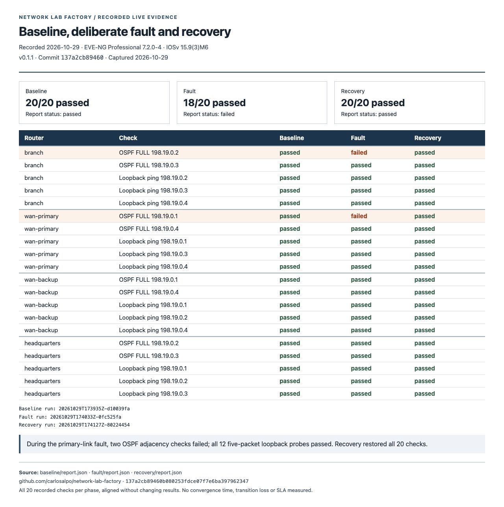

# Network Lab Factory

[](https://github.com/carlosalpo/network-lab-factory/actions/workflows/ci.yml)

**Turn a network scenario into a repeatable EVE-NG lab and an Ansible workflow.**

Network experiments are easier to trust when the topology, addressing, configuration
and acceptance checks come from the same source. This project takes a small YAML
scenario, validates the design, and generates the artifacts needed to build it.

The first scenario connects a branch to headquarters through two routed WAN paths.
OSPF costs prefer the primary path; loopback probes test the data plane independently
of the management network. The WAN routers are a teaching abstraction, not a model
of a commercial carrier service or SD-WAN product.

**v0.1.1 includes a recorded live validation** on EVE-NG Professional 7.2.0-4 and
IOSv 15.9(3)M6: 20/20 baseline checks, zero changes on a second configuration run,
forwarding over the backup path during a primary-link failure, and 20/20 checks
after recovery. The fault report correctly identifies two lost adjacencies.
See the [experiment and reviewed evidence](docs/live-validation.md) for exact
versions, corrections and limits. Convergence time and loss during switchover were not measured.

Browse the [visual evidence gallery](docs/screenshots/README.md) for recorded
baseline/fault/recovery reports, route observations, repeatability and fresh local tests.



## What is included

| Stage | Deliverable |
|---|---|
| Validate | Reject duplicate IPs, subnet overlaps, reused ports, disconnected nodes and unknown fields |
| Build | EVE-NG `.unl`, Ansible inventory, IOS routing previews and integrity manifest |
| Provision | Ansible uploads a new lab after checking the image, bridge and destination |
| Bootstrap | Private console snippets establish management SSH using credentials supplied locally |
| Configure | Ansible configures data interfaces, loopbacks, OSPF costs and passive interfaces |
| Verify | Read-only collection of OSPF neighbors and loopback pings; JSON and Markdown reports |

Provisioning deliberately refuses to overwrite an existing lab. Bootstrap is a
one-time **manual console step** on each fresh router. Nodes are started from the
EVE-NG interface. GNS3, automatic console onboarding, lifecycle API integration and
automatic teardown are future work, not current features.

## Try it without EVE-NG

Requires Python 3.11 or newer. Run these commands from the repository root:

```bash
git clone https://github.com/carlosalpo/network-lab-factory.git
cd network-lab-factory
python3 -m venv .venv
source .venv/bin/activate
python -m pip install -e '.[dev]'

nlf validate examples/dual-wan.yml
nlf build examples/dual-wan.yml --output build/dual-wan
pytest -q
```

No credentials, network devices or proprietary images are required for these steps.
The example image name is a placeholder, so the example can be compiled but cannot
be provisioned unchanged.

Inspect the output:

```text
build/dual-wan/
  dual-wan.unl       EVE-NG topology: 4 IOSv routers, 4 data links, management bridge
  inventory.yml     Connection variables and per-router intent
  scenario.yml      Validated source snapshot
  manifest.json     Scenario fingerprint and generated-file hashes
  configs/          IOS data-plane previews, without credentials
```

Builds are deterministic for an identical scenario. A build requires a new output
directory, preventing old files from being mistaken for current evidence.
The manifest detects accidental edits; it is not a signed security attestation.

## The dual-WAN scenario

| Link | Endpoints | OSPF cost at each end |
|---|---|---|
| Primary access | branch Gi0/1 ↔ wan-primary Gi0/1 | 10 |
| Primary transit | wan-primary Gi0/2 ↔ headquarters Gi0/1 | 10 |
| Backup access | branch Gi0/2 ↔ wan-backup Gi0/1 | 100 |
| Backup transit | wan-backup Gi0/2 ↔ headquarters Gi0/2 | 100 |

Every router reserves Gi0/0 for an isolated management bridge. Management addresses
are not advertised into OSPF. Each router has a distinct /32 loopback, and verification
sends five ICMP probes from Loopback0 to every other loopback.

This separation matters: successful SSH access alone does not prove that routing works.

## Run it on your lab

Follow the [deployment guide](docs/deployment.md). You will need:

- An EVE-NG installation with the `vios` template and a lawfully obtained IOSv image.
- An isolated `pnet1`–`pnet9` bridge reachable from your Ansible controller.
- SSH access to the EVE host and fresh routers dedicated to this experiment.
- The Python Ansible extra and the collections in `ansible/requirements.yml`.

The documented resource request is 4 × 512 MiB RAM and 4 virtual CPUs for the routers,
plus EVE-NG and hypervisor overhead. Image-specific requirements may differ.

```bash
python -m pip install -e '.[ansible]'
ansible-galaxy collection install -r ansible/requirements.yml
```

Use a local scenario copy with your exact installed image and management addresses.
No vendor image is downloaded or included by this project.

## Evidence, not green badges for missing data

`nlf verify` creates a new run directory every time. A report can be:

- **passed**: every expected neighbor is FULL, every five-packet probe succeeds,
  and Ansible completes successfully;
- **failed**: observed evidence fails a check;
- **incomplete**: evidence is missing, stale, malformed or could not be collected.

Exit codes are `0` for success, `1` for a failed/incomplete verification, and `2`
for invalid input or local setup errors. Evidence from another run or scenario is
not reused. A router that cannot be reached remains unknown.

Read the [validation boundary](docs/validation.md) before interpreting a result.
The [failover exercise](docs/failover.md) explains a controlled manual failure and
recovery without claiming a measured convergence SLA.

## Design choices

- **One scenario model:** addressing, wiring, router intent and expected checks are linked.
- **A small supported surface:** IPv4, IOSv with four interfaces, one OSPF area and
  point-to-point links. Unsupported platforms are rejected rather than guessed.
- **Explicit management:** no automatic use of EVE's primary `pnet0` bridge.
- **No production inventory:** all committed example data is synthetic.
- **No stored credentials:** Ansible reads runtime environment variables. Console
  snippets are created separately with private filesystem permissions.
- **Fresh dedicated labs:** configuration is additive. It does not reconcile arbitrary
  pre-existing routing policies or remove obsolete objects after a design change.

## Repository guide

| Location | Purpose |
|---|---|
| `examples/dual-wan.yml` | Synthetic, editable scenario |
| `src/netlab/model.py` | Validation and address rules |
| `src/netlab/build.py` | EVE XML, inventory and routing artifact generation |
| `src/netlab/report.py` | Evidence evaluation |
| `ansible/` | Provision, configure and verify workflows |
| `tests/` | Positive and negative offline tests |
| `docs/` | Deployment, validation and failover guide |

## Next milestones

1. Extend compatibility testing to additional EVE-NG and IOSv versions.
2. Automate node startup and management onboarding for that tested combination.
3. Add a GNS3 adapter against a pinned, tested API version.
4. Add controlled fault injection, recovery checks and measured convergence experiments.

## Author and license

Created by [Carlos Alvarado](https://github.com/carlosalpo), Technology Solutions Architect.
MIT licensed. EVE-NG, Ansible and Cisco IOSv remain separate projects/products with
their own licenses and requirements. This is an independent learning and engineering tool.
