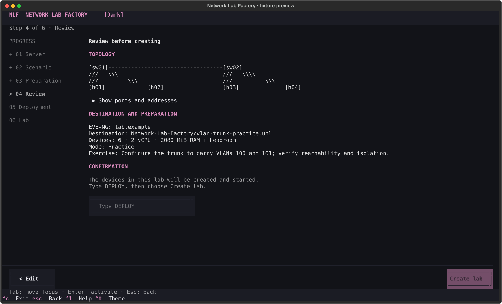
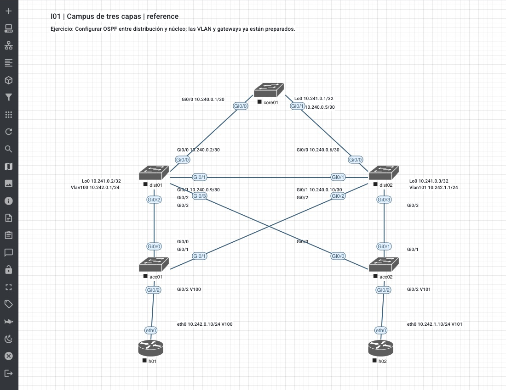
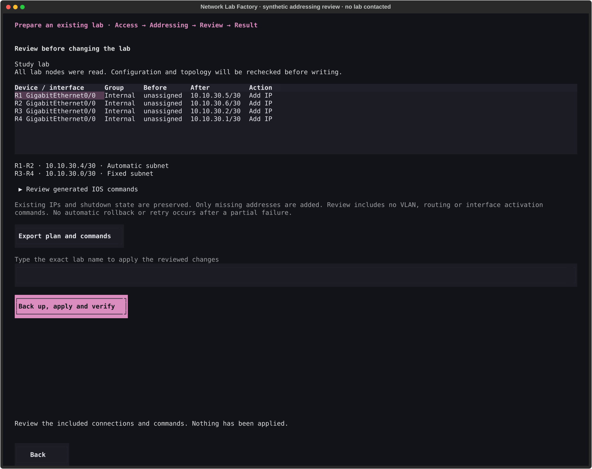
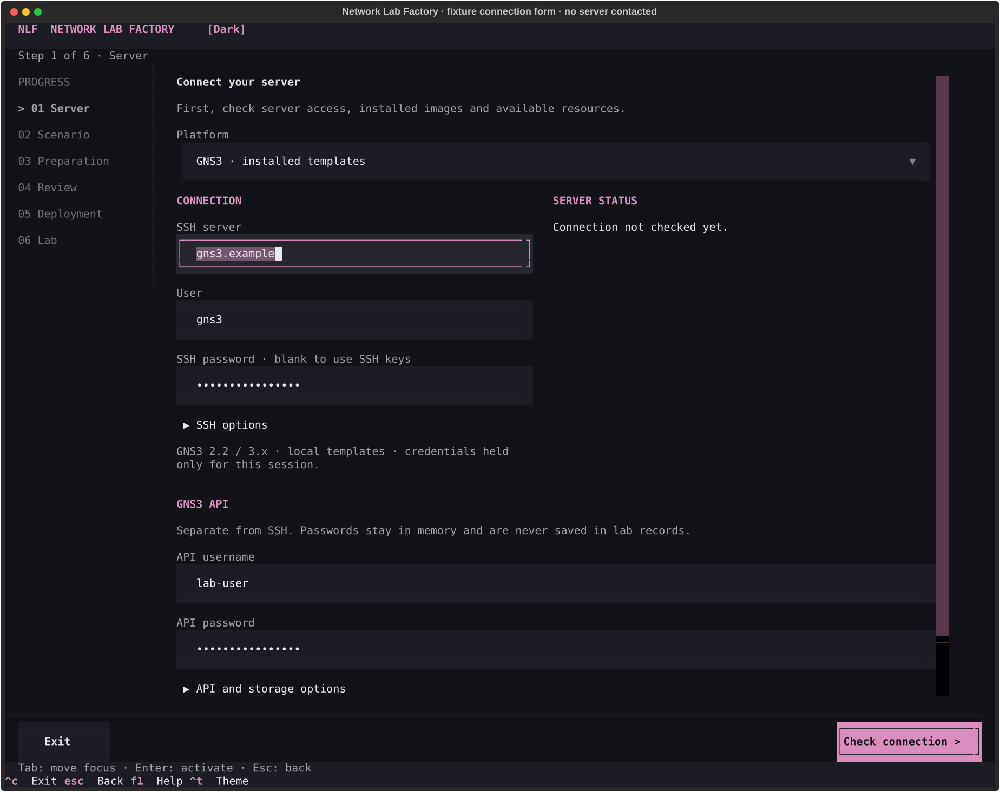

# Network Lab Factory

[](https://github.com/carlosalpo/network-lab-factory/actions/workflows/ci.yml)

**Build repeatable network labs in EVE-NG and GNS3, from setup to verification.**

Network Lab Factory is a guided terminal application that prepares network labs in **EVE-NG and GNS3**. Instead of repeatedly adding devices, wiring interfaces and configuring the same prerequisites, select a scenario and let the assistant build a new lab from its recipe.

Use **Practice** mode to configure the exercise yourself, or **Reference** mode to deploy and check the supplied solution. The same recipe supplies the topology, addressing, configuration and acceptance checks.

Already built your topology? The new **[existing-lab addressing assistant](docs/existing-labs.md)** lets you organize IPv4 pools by group, pin selected subnets or hosts, and fill the remaining connections automatically. This preview preserves existing addresses and shows the commands before application. Fresh real-server validation of this new mode is pending.

[Quick start](#quick-start) · [24 scenarios](docs/catalog/README.md) · [How it works](#how-it-works) · [Validation](#tested-on-real-lab-platforms) · [Setup guide](docs/workshop-wizard.md)

## From the assistant to your lab

### 1. Review before creating

Choose the platform, scenario, installed images and address pools. The review screen brings the topology, resource request and learning objective together before you confirm deployment.



*Actual application widgets rendered with fixture inventory. The English interface is shown with demo data, not a live deployment. [Capture method and more screens](docs/screenshots/workshop/README.md).*

### 2. Open the native topology in EVE-NG

The generated lab appears in EVE-NG with device names, interface labels and addressing. This example is **I01: three-tier campus**, with a core switch, two distribution switches, two access switches and two hosts.



*Native EVE-NG capture recovered from the recorded QA campaign. It shows the topology layout, not a new protocol test or a current running-state claim. Only the canvas and EVE controls are retained. [Image provenance](docs/screenshots/platforms/README.md) · [I01 scenario](docs/catalog/I01.md) · [Recorded EVE observations](docs/evidence/catalog/eve-i01-reference.json).*

### 3. Use the GNS3 backend

Choose GNS3 in the same assistant to create the scenario as a native GNS3 project, including nodes, links and labels. The [GNS3 setup guide](docs/workshop-wizard.md#gns3) documents the portable connection requirements and template selection; the [validation matrix](docs/catalog-validation.md) links the recorded device checks for every scenario.

## What you can build

The catalog contains **24 implemented scenario variants**, each with its own topology, image profiles, resource requirements, prepared configuration, learner exercise and observable checks.

| Level | Explore the catalog |
| --- | --- |
| **Basic · 8 scenarios** | [OSPF](docs/catalog/B01.md), [static routes](docs/catalog/B02.md), [VLANs and trunks](docs/catalog/B03.md), [LACP](docs/catalog/B04.md), [STP](docs/catalog/B05.md), [three-switch ring](docs/catalog/B06.md), [four-switch ring](docs/catalog/B07.md), [inter-VLAN routing](docs/catalog/B08.md) |
| **Intermediate · 8 scenarios** | [Three-tier campus](docs/catalog/I01.md), [multi-area OSPF](docs/catalog/I02.md), [dual WAN](docs/catalog/I03.md), [redundant gateway](docs/catalog/I04.md), [BGP](docs/catalog/I05.md), [VRFs](docs/catalog/I06.md), [ACL/NAT](docs/catalog/I07.md), [IPv6 and dual stack](docs/catalog/I08.md) |
| **Advanced · 8 scenarios** | [Nexus vPC](docs/catalog/A01.md), [VXLAN EVPN](docs/catalog/A02.md), [MPLS L3VPN](docs/catalog/A03.md), [redistribution](docs/catalog/A04.md), [BGP multihoming](docs/catalog/A05.md), [ASA segmentation](docs/catalog/A06.md), [troubleshooting](docs/catalog/A07.md), [NX-OS version comparison](docs/catalog/A08.md) |

Start with **B01: two-router OSPF**. For switching, try **B04: LACP**. Advanced scenarios require substantially more memory; check each scenario's resource table before deploying.

### Two ways to use the same scenario

| Mode | The tool prepares | You do |
| --- | --- | --- |
| **Practice** | Devices, links, base configuration and prerequisite checks | Configure the exercise, then run its checks |
| **Reference** | The same base plus the exercise solution and its checks | Inspect a working reference and study the resulting configuration |

For example, B01 Practice prepares interface addresses and loopbacks but leaves OSPF for you. B01 Reference also configures OSPF and requires the exercise checks to pass. “Ready” in Practice means the prerequisites passed; it does not mean the unfinished exercise passed.

## Quick start

Requires **Python 3.11+**. Install and open the assistant:

```sh
git clone https://github.com/carlosalpo/network-lab-factory.git
cd network-lab-factory
python3 -m venv .venv
source .venv/bin/activate
python -m pip install -e .
nlf wizard
```

The terminal interface and plain prompts are in **English**, including all 24 scenario summaries, validation messages and recovery guidance.

In the assistant: **Server → Scenario → Preparation → Review → Deployment → Lab**. Check the destination and type `DEPLOY` to confirm creation. The result view lets you open device consoles and recheck the preparation or exercise.

Prefer a light theme, monochrome display or linear prompts?

```sh
nlf wizard --theme light
nlf wizard --theme mono
nlf wizard --plain
```

### Prepare an existing laboratory

Run `nlf existing`, enter the server details, then choose **Prepare existing lab**. Browse your EVE-NG folders or GNS3 projects, read the running routers, and add pools such as `Internal: 10.10.30.0/24` and `External: 10.20.0.0/24`. Include all eligible direct links at once or set each connection individually. Fixed choices are reserved before automatic assignment.



*Actual application widgets with a synthetic four-router topology; no real server was contacted for this capture. Existing lab discovery, allocation, failure handling and the UI are covered by automated tests. [Scope, safety gates and walkthrough](docs/existing-labs.md).*

This first version supports observed IOS/IOSv physical routed IPv4 interfaces. It does not configure VLANs, VRFs, routing protocols or interface activation. **Export** writes a private plan; **Apply** requires the exact lab name and backs up running configurations on the SSH server; **Save permanently** is a separate confirmation after verification. Unread or unsupported lab nodes make the plan export-only.

### Explore before connecting a server

Catalog browsing and planning work locally. These commands prepare plans; they do not deploy devices:

```sh
nlf catalog
nlf plan B03 --name vlan-trunk --mode reference --output build/vlan-trunk
nlf plan A02 --backend gns3 --name evpn-practice --output build/evpn-practice
```

### Connect your lab platform

| Platform | Documented profile | Access |
| --- | --- | --- |
| **EVE-NG** | Professional 7.2.0-4, admin / tenant 0 | SSH to the EVE host; required templates, runtime and compatible images installed |
| **GNS3** | API v2 (2.2.x) or v3 (3.x), subject to capability checks | SSH to a Linux server / GNS3 VM with a local compute and existing QEMU/VPCS templates |

Follow the **[setup and troubleshooting guide](docs/workshop-wizard.md#conectores-disponibles)** for host prerequisites, authentication and environment variables. Compatible operating-system images must already be installed; this repository does not distribute or download vendor images. The portable assistant discovers the server API and uses your installed templates, including their disk names, BIOS and QEMU path. It does not infer operating-system compatibility from a template name. Multi-compute deployments, non-Telnet consoles and non-QEMU/VPCS emulators are outside this connector’s current scope. The original Nexo/Proxmox transport remains available for existing saved labs.

### Enter credentials in the assistant

In **Server**, enter the host, SSH user and masked **SSH password** (or leave it blank for your existing SSH key). For GNS3, enter the separate **API username** and **API password**, then choose **Check connection**. The default API address is server loopback, reached inside the encrypted SSH connection.



*Actual terminal widgets with public fixture values; no server was contacted. Passwords are masked and excluded from the SVG. [Setup, compatibility and security](docs/portable-connections.md).*

Passwords and API tokens are held only for the active session: no password file, shell argument, environment variable or saved lab record is used. SSH host keys and HTTPS certificates remain verified. Reopening a saved lab requests its passwords again. In **Preparation**, choose an installed template for each OS family; the assistant checks adapter counts, image availability and actual template RAM before confirmation.

**Validation boundary:** the historical 24/24 GNS3 campaign below used the original Nexo connector. It does not certify the new portable transport. The new transport has automated API, security and UI coverage; a fresh hardware campaign remains pending.

## How it works

| Step | What the assistant does | What you can inspect |
| --- | --- | --- |
| **Discover** | Checks the connection, installed compatible images and available resources | Platform, image choices and resource availability |
| **Plan** | Resolves the chosen recipe, mode and address pools | Device names, links, ports, addresses and requested resources |
| **Create** | Creates a new native lab/project and connects its devices | EVE-NG topology or GNS3 project with native labels |
| **Prepare** | Starts devices and applies the recipe's base configuration; adds the solution in Reference mode | Progress events and device consoles |
| **Check** | Collects device observations and evaluates the defined checks | Separate preparation/exercise results and recorded output |

Each deployment retains a new local directory with the recipe, topology, commands, events and results. EVE-NG exports a `.unl` lab; GNS3 exports a `gns3-request.json` describing the project creation request. Keep the run directory to reopen the lab menu:

```sh
nlf workshop build/workshops/<name>-<id>
nlf lab-action build/workshops/<name>-<id> check-base
nlf lab-action build/workshops/<name>-<id> check-exercise
```

The assistant refuses an existing destination. Interrupted operations retain their records and may leave created or running devices; inspect the lab before recovery. Fault and restore actions are available only where the recipe defines them, require confirmation, and invalidate previous observations until you recheck.

## Tested on real lab platforms

| Recorded campaign | Result | Evidence |
| --- | --- | --- |
| EVE-NG reference scenarios | **24 / 24 passed** | [Per-scenario observations](docs/catalog-validation.md) |
| GNS3 reference scenarios | **24 / 24 passed** | [Per-scenario observations](docs/catalog-validation.md) |
| Local automated suite during the campaign | **217 tests passed** | [Validation record](docs/catalog-validation.md#additional-observations) |
| Additional checks | Five GNS3 Practice samples, selected fault/recovery cases and Nexus automatic restart | [Evidence index](docs/evidence/catalog/README.md) |

The matrix records the tested versions, corrections made after failed attempts and links to the final observations. These results cover the documented variants and images; they are not universal compatibility or production-readiness claims. Performance and convergence time were not measured. [Campaign cleanup](docs/cleanup-validation.md) is documented separately.

For contributors, run the local suite without a lab server:

```sh
python -m pip install -e '.[dev]'
pytest -q
ruff check src tests
```

## Scope and documentation

Recipes have fixed device counts and topology variants. Arbitrary topology generation, external address reservations and general multiuser platform connectors are outside the current implementation. Labs use their own internal links and do not automatically attach to a physical or production network.

| Read next | Contents |
| --- | --- |
| [Scenario catalog](docs/catalog/README.md) | All 24 guides, topology, resources and learning objectives |
| [Wizard guide](docs/workshop-wizard.md) | Authentication, image profiles, navigation, consoles and recovery |
| [Validation matrix](docs/catalog-validation.md) | Recorded observations and exact validation boundaries |
| [Native platform captures](docs/screenshots/platforms/README.md) | Lab topology images and their provenance |
| [Terminal capture gallery](docs/screenshots/workshop/README.md) | Application screens and how they were captured |
| [Original YAML/Ansible workflow](docs/dual-wan-workflow.md) | The earlier dual-WAN compiler, provisioning and manual bootstrap workflow |
| [Changelog](CHANGELOG.md) | Project evolution |

The original YAML/Ansible workflow remains available. Its manual bootstrap instructions and historical v0.1.1 evidence are kept in the dedicated guide so they are not confused with the current catalog assistant.

## Author and license

Created by [Carlos Alvarado](https://github.com/carlosalpo), Technology Solutions Architect. **MIT licensed** — see [LICENSE](LICENSE).

Independent project. EVE-NG, GNS3, Ansible and vendor operating systems retain their own licenses and requirements.
