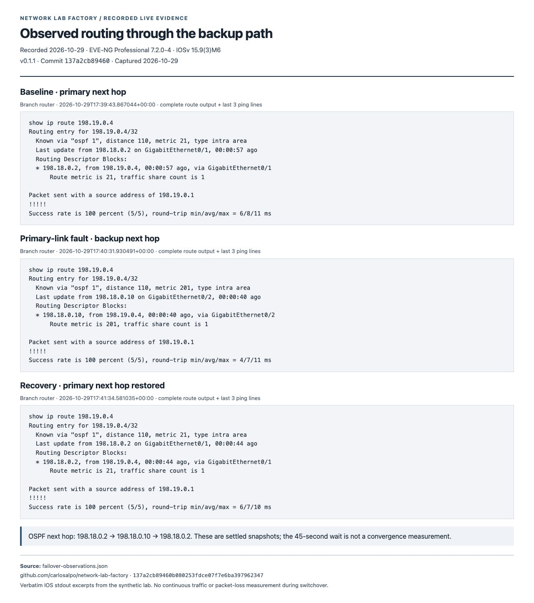
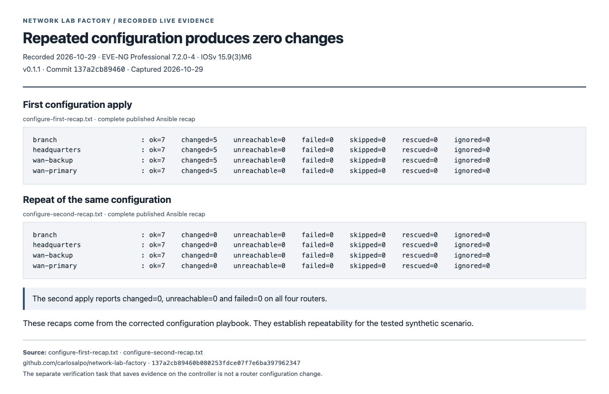
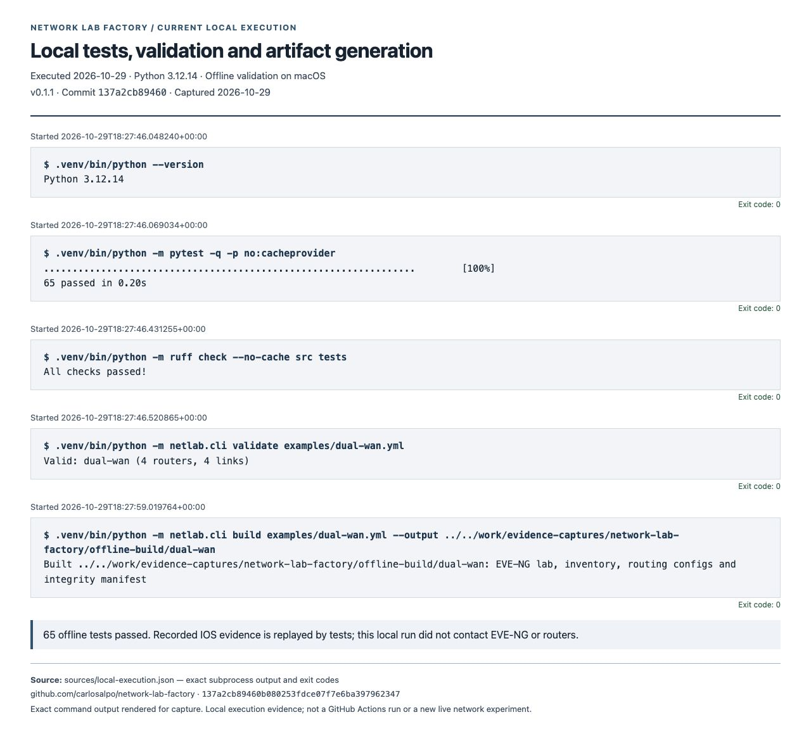

# Network Lab Factory evidence captures

Four browser captures prepared on 29 October 2026 for release **v0.1.1**, commit `137a2cb89460b080253fdce07f7e6ba397962347`. Images 01–03 render the recorded live experiment; image 04 renders commands executed locally on the capture date. All four images have been visually reviewed.

## Portfolio selection

Use images **01** and **02** together: the first shows every recorded check and the second supplies the IOS route observations. Preserve the historical date and the measurement limits in their captions.

## Recorded verification across three phases

Recorded EVE-NG/IOSv validation: 20/20 baseline checks, 18/20 during a deliberate primary-link fault, and 20/20 after recovery. Both lost OSPF adjacencies are reported while all 12 loopback probes pass during the fault.

- Evidence date and capture date: **2026-10-29**. Version: **v0.1.1**. Commit: `137a2cb89460b080253fdce07f7e6ba397962347`.
- Proves: All 60 check outcomes from three recorded reports; fault detection remains visible despite successful forwarding.
- Rendering: All checks aligned by router and check label; status strings preserved; counts calculated directly from recorded checks.
- Source: [docs/evidence/2026-10-29/baseline/report.json](https://github.com/carlosalpo/network-lab-factory/blob/137a2cb89460b080253fdce07f7e6ba397962347/docs/evidence/2026-10-29/baseline/report.json); [bundled snapshot](sources/recorded/baseline/report.json).
- Source: [docs/evidence/2026-10-29/fault/report.json](https://github.com/carlosalpo/network-lab-factory/blob/137a2cb89460b080253fdce07f7e6ba397962347/docs/evidence/2026-10-29/fault/report.json); [bundled snapshot](sources/recorded/fault/report.json).
- Source: [docs/evidence/2026-10-29/recovery/report.json](https://github.com/carlosalpo/network-lab-factory/blob/137a2cb89460b080253fdce07f7e6ba397962347/docs/evidence/2026-10-29/recovery/report.json); [bundled snapshot](sources/recorded/recovery/report.json).
- Recorded run IDs: `20261029T173935Z-d10039fa`, `20261029T174033Z-0fc525fa`, `20261029T174127Z-80224454`.

## Recorded primary and backup routing

Recorded IOSv route snapshots show the branch switching to the backup next hop during the primary-link fault and returning to the primary next hop after restoration. Each settled snapshot includes a successful five-packet probe; convergence time and loss during switchover were not measured.

- Evidence date and capture date: **2026-10-29**. Version: **v0.1.1**. Commit: `137a2cb89460b080253fdce07f7e6ba397962347`.
- Proves: Observed primary to backup to primary next-hop changes for the headquarters loopback in the synthetic lab.
- Rendering: Complete route stdout for each phase plus the final three lines of each ping stdout; CRLF normalized for browser display; source fields otherwise unchanged.
- Source: [docs/evidence/2026-10-29/failover-observations.json](https://github.com/carlosalpo/network-lab-factory/blob/137a2cb89460b080253fdce07f7e6ba397962347/docs/evidence/2026-10-29/failover-observations.json); [bundled snapshot](sources/recorded/failover-observations.json).

## Recorded configuration repeatability

Recorded Ansible configuration recaps show changed=5 on the first apply and changed=0 on the second apply for all four IOSv routers, with no unreachable hosts or failed tasks.

- Evidence date and capture date: **2026-10-29**. Version: **v0.1.1**. Commit: `137a2cb89460b080253fdce07f7e6ba397962347`.
- Proves: Idempotence of the corrected configuration playbook for this tested scenario.
- Rendering: Complete published recap text with trailing newline removed for display.
- Source: [docs/evidence/2026-10-29/configure-first-recap.txt](https://github.com/carlosalpo/network-lab-factory/blob/137a2cb89460b080253fdce07f7e6ba397962347/docs/evidence/2026-10-29/configure-first-recap.txt); [bundled snapshot](sources/recorded/configure-first-recap.txt).
- Source: [docs/evidence/2026-10-29/configure-second-recap.txt](https://github.com/carlosalpo/network-lab-factory/blob/137a2cb89460b080253fdce07f7e6ba397962347/docs/evidence/2026-10-29/configure-second-recap.txt); [bundled snapshot](sources/recorded/configure-second-recap.txt).

## Current offline execution

Local validation of Network Lab Factory v0.1.1 on 29 October 2026: all 65 offline tests passed, Ruff reported no findings, and the example scenario validated and generated EVE-NG, inventory, routing and integrity artifacts. This run did not contact network devices.

- Evidence date and capture date: **2026-10-29**. Version: **v0.1.1**. Commit: `137a2cb89460b080253fdce07f7e6ba397962347`.
- Proves: Successful local offline test, lint, scenario validation and build commands on Python 3.12.14; not a CI screenshot or live device rerun.
- Rendering: Exact recorded command strings and stdout rendered as text; commands marked with a display-only dollar prompt; exit codes displayed from subprocess results.
- Source: [sources/local-execution.json](sources/local-execution.json); [bundled snapshot](sources/local-execution.json).

## Scope and reproducibility

The live experiment used EVE-NG Professional 7.2.0-4 and IOSv 15.9(3)M6. Probes were collected after settling; the 45-second wait was not a convergence measurement. Convergence time, packet loss during the transition and SLA were not measured. No lab nodes were started during capture preparation.

The release tag was checked against GitHub and matches the local commit. All bundled historical sources are byte-for-byte equal to that commit; the seven tested-source fingerprints also match the current source files. The local run used Python 3.12.14 and returned exit code 0 for every recorded command. It does not establish the status of a remote CI job.

The HTML views are report renderings prepared for these screenshots, not a product dashboard or an EVE console. No image generation, terminal simulation, or pixel editing was used. The router names and 198.18/198.19 addresses belong to the synthetic test lab.

## Integration

This gallery includes the images, manifest, source records and HTML views used for capture. The local build output itself is not bundled; its execution is recorded in `sources/local-execution.json`. Capture preparation left product source and infrastructure unchanged.

The manifest records captions, source links, dimensions, SHA-256 hashes, rendering details and the portfolio selection. To verify file integrity, run `shasum -a 256 -c SHA256SUMS.txt` from this delivery folder.
